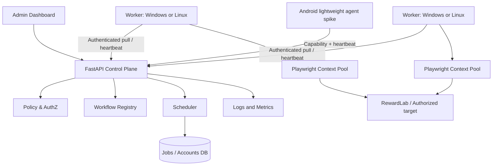

# ARCHITECTURE.md — Technical Contract v1

## 1. Product definition

**Adaptive Distributed Browser Automation Platform (ADBAP)** is a self-hosted, workflow-driven automation system for applications the operator owns or has explicit permission to automate. Primary acceptance environment: **RewardLab**, a purpose-built local mock website featuring task lists, fake point accrual and synthetic accounts. Microsoft Rewards integration is **companion-only**: user-driven links, reminders and manual activity history. No direct multi-account Rewards automation.

Non-goals: stealth automation, circumventing anti-fraud/verification, unsolicited web scraping, monetizing automated reward programs, automatic gift redemption, agent-generated executable code.

## 2. Context diagram



## 3. Boundaries / invariants

- API: validates request and permissions, creates job; never starts long-running browser execution inside HTTP request or FastAPI BackgroundTasks.
- Scheduler: account affinity, per-account mutual exclusion, per-node concurrency, capability matching, job state decisions.
- Worker: claim -> validate -> run -> verify side effect -> report; no authority to change policy, forge approvals or grant itself accounts.
- Browser Manager: one Chromium process with independent ephemeral contexts in MVP; per-account encrypted storage state where authorized, close in `finally`.
- Rewards Companion: no credentials, cookies, browsing automation or automatic point earning on Microsoft services.
- RewardLab: local owned service allowing end-to-end automation and fault injection.

## 4. Suggested repository layout

```text
backend/
  pyproject.toml
  app/
    api/                # accounts, providers, workflows, jobs, nodes, metrics
    core/               # configuration, policy, errors, security
    domain/             # models, enums, state transitions, DTOs
    workflows/          # DSL schema, parser, action registry, validator
    execution/          # Playwright adapter, context manager, actions
    orchestration/      # scheduler, leases, locks, rate limits
    persistence/        # SQLAlchemy models, repositories, migrations
    integrations/       # RewardLab adapter, Rewards companion
    observability/      # metrics, logging, trace filters
  tests/
frontend/               # Next.js TypeScript dashboard
rewardlab/               # local mock website + fake account fixtures
workers/                 # standalone worker process/agent
examples/workflows/      # declarative safe examples
docs/
  ARCHITECTURE.md
  IMPLEMENTATION_PLAN.md
AGENTS.md
START_PROMPT.md
.env.example
```

## 5. Domain model (core tables)

| Entity | Important columns / constraints |
|---|---|
| `providers` | id PK, adapter_kind, policy_version, capabilities_json |
| `accounts` | id PK, provider_id FK, owner_id, label, assigned_node_id nullable, auth_state, unique(provider_id, owner_id, label) |
| `session_refs` | id PK, account_id FK, vault_ref, key_version, expires_at; no plaintext cookies |
| `workflow_versions` | id PK, workflow_key, version, provider_id, schema_version, definition_json, approval_status, immutable after publication |
| `jobs` | id PK, workflow_version_id FK, account_id FK, status, idempotency_key unique scoped to account+workflow, scheduled_at, attempt, max_attempts, lease_owner, lease_token, lease_until, result_ref |
| `job_steps` | id PK, job_id FK, step_key, status, started_at, finished_at, error_code; unique(job_id, step_key, attempt) |
| `nodes` | id PK, display_name, node_type, capability_json, max_concurrency, heartbeat_at, state |
| `audit_events` | id PK, actor, action, resource, outcome, time, sanitized_details |
| `activity_records` | id PK, provider_id, account_id nullable, activity_key, user_confirmed_at, verification_source |

Start with SQLite local and Alembic; migrate to PostgreSQL before multi-host. Use transaction-safe claim (`FOR UPDATE SKIP LOCKED` where supported) and lease fencing in distributed phase.

## 6. Job and worker protocol

States: `PENDING -> VALIDATING -> QUEUED -> LEASED -> RUNNING -> SUCCEEDED | FAILED | RETRY_WAIT | PAUSED_FOR_REVIEW | CANCELLED | REJECTED`.

Claim is atomic: select eligible queued job, validate policy/account/node capability, ensure no simultaneous active job for account, increment lease token, set lease_until. Heartbeat renews only the matching active lease owner/token. Result is accepted only for the current fencing token. Expired leases trigger **reconciliation**, not blind replay. Unique idempotency key prevents duplicate job creation. External side effects require explicit verified postconditions; otherwise pause for review.

Suggested API v1 (prefix `/api/v1`):
- `GET /health`, `GET /providers`, `GET /accounts`, `POST /accounts`
- `GET /workflows`, `POST /workflows`, `POST /workflows/{id}/validate`, `POST /workflows/{id}/approve`
- `POST /jobs`, `GET /jobs/{id}`, `POST /jobs/{id}/cancel`
- `POST /nodes/register`, `POST /nodes/{id}/heartbeat`, `POST /jobs/claim`, `POST /jobs/{id}/heartbeat`, `POST /jobs/{id}/complete`, `POST /jobs/{id}/fail`
- `GET /metrics/summary`, `GET /audit-events`

Worker authentication: short-lived node credentials and HTTPS; rotate/revoke nodes; per-node scopes. For local-only PoC use loopback and development credentials, never hardcoded in Git.

## 7. Workflow DSL v1

Use strictly schema-validated YAML/JSON. No arbitrary code, unapproved URLs, imports, external scripts, or AI-generated runtime evaluation. `provider` and `requested_capabilities` checked before any action.

```yaml
schema_version: 1
id: review_first_task
provider: rewardlab
requested_capabilities: [read_tasks, mark_reviewed]
execution:
  timeout_seconds: 30
  max_retries: 1
steps:
  - id: open_tasks
    action: navigate
    path: /tasks
  - id: read_task
    action: extract_text
    target: {by: test_id, value: task-description}
    output: description
  - id: mark_reviewed
    action: click
    target: {by: role, role: button, name: "Mark as reviewed"}
    side_effect: true
  - id: verify
    action: verify_state
    source: rewardlab_api
    field: reviewed
    equals: true
```

Supported v1 actions: `navigate`, `wait_visible`, `extract_text`, `click`, `fill`, `assert_visible`, `verify_state`, `save_result`, `notify_user`, `request_human_action`. For side effects, require postcondition and idempotency strategy. Reject unsupported keys/actions with clear code. Read-only AI proposals default to draft status.

## 8. Policy model

`provider_policy` includes: `automation_allowed`, `domain_allowlist`, `allowed_actions`, `required_capabilities`, `sensitive_action_requires_approval`, `allow_auth_storage`, `rate_limits`, `ai_allowed`.

Default:
- `rewardlab`: automation allowed on local environment; supports synthetic test accounts.
- `microsoft_rewards`: `automation_allowed: false`; only user-driven navigation/reminders/manual tracking; no login collection.
- all unknown providers: denied until documented explicit permission and operator/admin approval.

Validate resolved navigation URL AND redirects; protect against SSRF and sending authorized sessions to foreign domains. All policy decisions logged without secrets.

## 9. Security / observability / AI

Secrets vault boundary; per-account encrypted storage state for test providers; raw traces/screenshots disabled by default or redacted and time-limited. Stop on MFA, CAPTCHA, access restrictions. Respect retry-after. Non-sensitive metrics: attempts, success, p50/p95, job queue delay, RSS, CPU, node health, browser crash count.

AI is a separate optional adapter: goal + sanitized DOM/accessibility info -> structured workflow draft -> Pydantic validation -> policy check -> RewardLab sandbox dry run -> approval -> immutable workflow version. Never synthesize anti-detection variation or operate accounts beyond authorized scope. No credentials or cookies in prompts.

## 10. Android assumptions / exit criteria

Android is **not** counted as a Chromium worker by default. Agent spike checks outbound HTTPS registration, heartbeats, durable local queue, thermal/battery/memory constraints, OS background restrictions. Experimental Playwright Android control via ADB is a separate research task, not equivalent to desktop Chromium contexts. Only advertise `browser_automation` capability when a tested runtime exists. Alternative: Android agent dispatches explicitly permitted lightweight tasks while Linux workers execute browser tasks.

## 11. Decisions and tradeoffs

1. Modular monolith for control plane, separate OS worker process: lowest operational cost while preserving scaling boundary.
2. SQLite for one-host bootstrap; PostgreSQL for multi-worker leases: avoids unsafe SQLite claims across hosts.
3. Rule-based DSL before Recorder and AI: testable and auditable.
4. Windows/Linux desktop browser before Android browser: less unknown compatibility.
5. Approval and policy before execution: operational safety is a functional requirement, not a UI preference.
